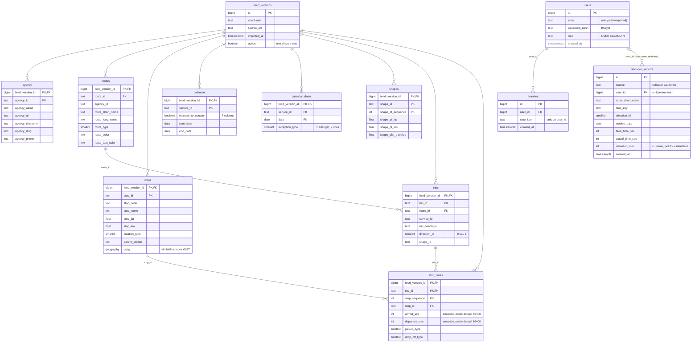

# Schema bazei de date

Sursa: [`V2__schema.sql`](../src/main/resources/db/migration/V2__schema.sql) (V1 e goală).
PostgreSQL 17 cu PostGIS, local (Docker Compose) și pe Neon. Deciziile: D-043, D-044.

## Cum se citește
- **Versiunile de feed (D-003, D-019, D-044).** Fiecare tabel GTFS are cheia
  `(feed_version_id, id-ul din GTFS)`, deci versiunea activă și cea anterioară stau una lângă
  alta (raportul de diferențe le compară). Ștergerea unei versiuni din `feed_versions` șterge în
  cascadă toate rândurile ei. Un singur rând are `active = true` (index unic parțial).
- **Orele (D-043).** `arrival_sec`, `departure_sec`, `feed_time_sec`, `actual_time_sec`: secunde de
  la începutul zilei de serviciu, ca în GTFS. 25:10:00 → 90600. Pe ecran și în CSV: HH:MM (D-024).
- **Datele utilizatorilor (D-020, D-044).** `favorites` și `deviation_reports` nu au chei străine
  spre tabelele GTFS: se leagă prin `route_short_name` și `stop_key`, care rămân la fel între
  versiuni. Ce conține `stop_key` (stop_code sau stop_id) e Q-019. O favorită ține cheia unui rând
  din stație; gruparea în stații (D-031) se face la citire.
- **Rapoartele de abatere (D-009, D-025).** Sursa „utilizator” are `user_id`; sursa „teren”
  (observațiile din `field/observations.csv`) nu are. Un raport șters de admin se șterge definitiv
  (D-045, propusă).
- **Ce nu e încă în schemă:** sărbătorile legale (D-015, punctul 7 din ROADMAP), tabelul de
  corespondență teren → feed (Q-020), raportul de diferențe (D-003).
- **Termenii:** `stops` = rânduri din `stops.txt` (o stație le grupează), `routes` = linii,
  `trips` = curse, `stop_times` = plecări (CONTEXT.md).
